

  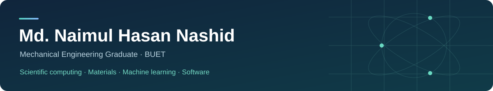

  <a href="https://sites.google.com/view/naimulnashid/naimul-nashid"><strong>Website</strong></a> &nbsp;·&nbsp;
  <a href="https://www.linkedin.com/in/nhnashid/">LinkedIn</a> &nbsp;·&nbsp;
  <a href="https://www.researchgate.net/profile/Md-Naimul-Hasan-Nashid">ResearchGate</a> &nbsp;·&nbsp;
  <a href="mailto:nashid2512@gmail.com">Email</a>

  B.Sc. with Honours, June 2026 &nbsp;·&nbsp; CGPA <strong>3.78/4.00</strong> &nbsp;·&nbsp; Rank <strong>23/186</strong>

I explore physics-based modeling, machine learning and materials simulation, and build practical software using an AI-assisted workflow. I am preparing for <strong>Fall 2027 PhD opportunities in Mechanical Engineering</strong>.

## Featured Applications

<table>
<tr>
<td width="33%" valign="top">

<h3><a href="https://github.com/naimulnashid/ai-usage-native">AI Usage</a></h3>

Token usage, estimated costs and runtime for Claude Code and Codex.

Windows · C# / WinUI 3

</td>
<td width="33%" valign="top">

<h3><a href="https://github.com/naimulnashid/music-vault">Music Vault</a></h3>

A self-hosted music library across Windows, Android and the web.

Rust · TypeScript · Kotlin

</td>
<td width="33%" valign="top">

<h3><a href="https://github.com/naimulnashid/nand-watch">NAND Watch</a></h3>

NVMe health history, endurance estimates and alerts.

Windows · C# / WinUI 3

</td>
</tr>
<tr>
<td width="33%" valign="top">

<h3><a href="https://github.com/naimulnashid/data-usage-native">Data Usage</a></h3>

Persistent per-app network history, with desktop and web versions.

Windows · Web · Android reporter

</td>
<td width="33%" valign="top">

<h3><a href="https://github.com/naimulnashid/internet-speed-meter-native">Internet Speed Meter</a></h3>

Taskbar upload/download rates, connection history and speed tests.

Windows · C# / WinUI 3

</td>
<td width="33%" valign="top">

<h3><a href="https://github.com/naimulnashid/screen-time-native">Screen Time</a></h3>

Foreground-app usage history with desktop and web views.

Windows · Web · Android reporter

</td>
</tr>
</table>

   &nbsp;
  <strong>Also:</strong> <a href="https://github.com/naimulnashid/token-distribution">Token Distribution</a> — a Claude Code mod for token categories and cache timers.

## Toolkit

<table>
<tr>
<td width="33%" valign="top"><strong>Computing</strong>
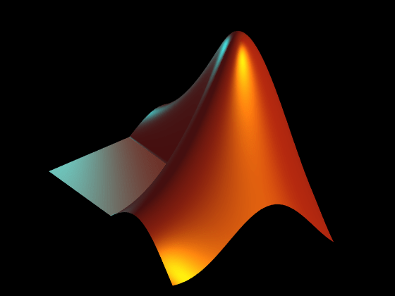 &nbsp; 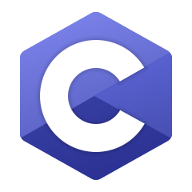
Python · MATLAB · C</td>
<td width="33%" valign="top"><strong>CAD & Simulation</strong>
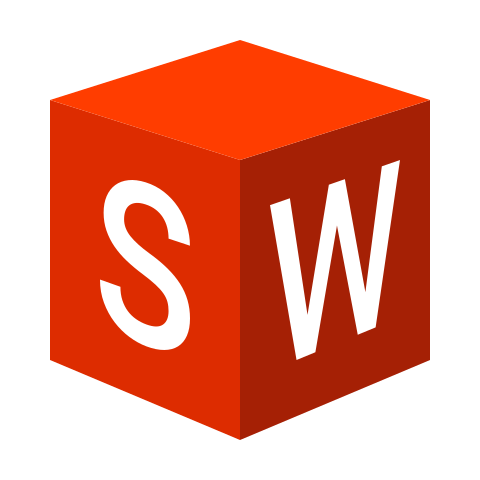 &nbsp; 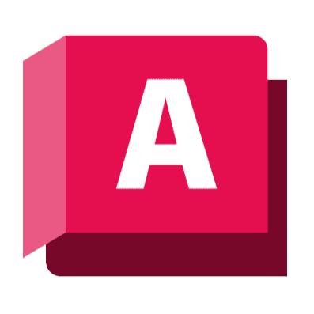 &nbsp; 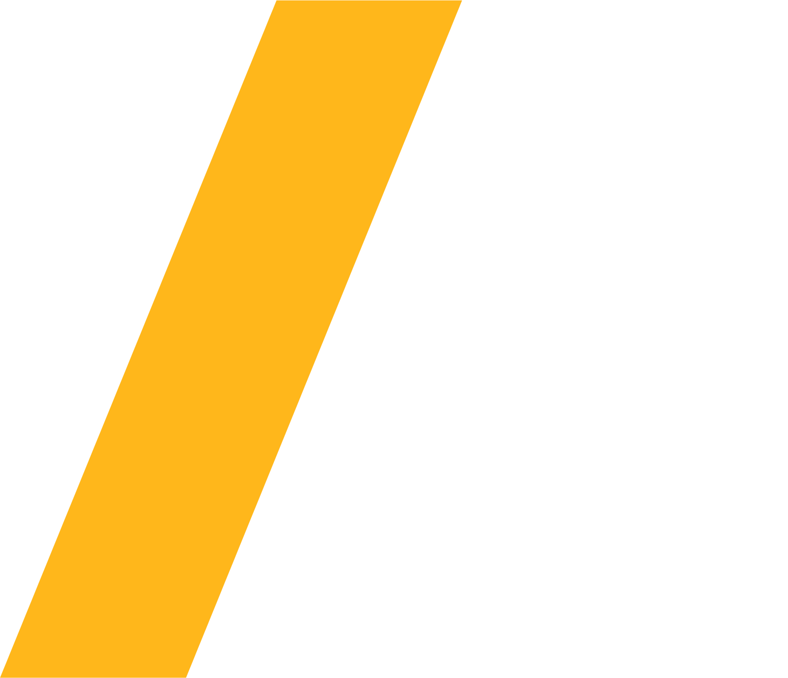 &nbsp; 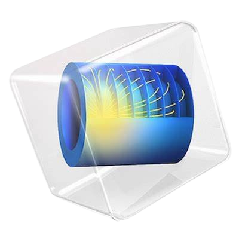
Design and thermal/fluid analysis</td>
<td width="33%" valign="top"><strong>Machine Learning</strong>
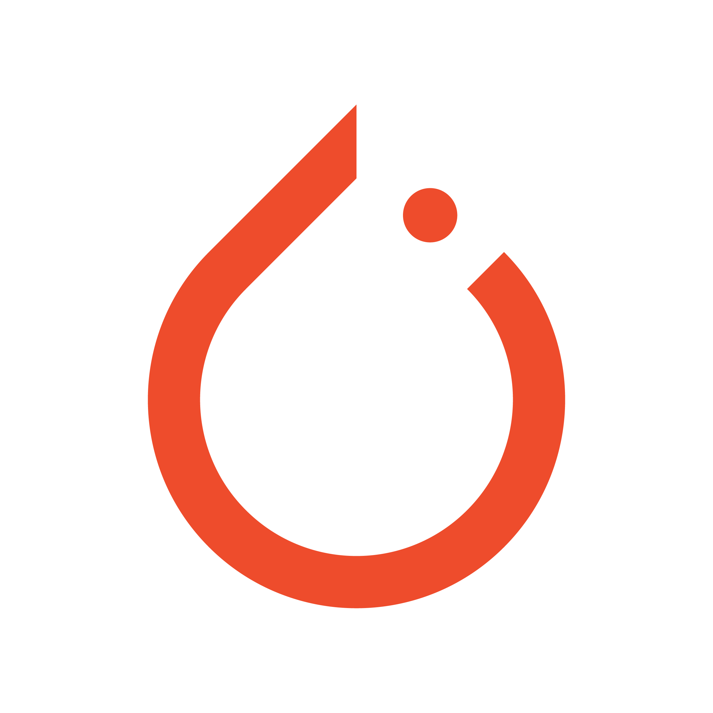 &nbsp; 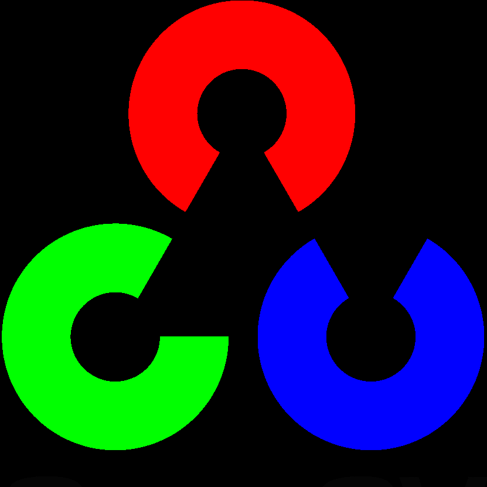 &nbsp; 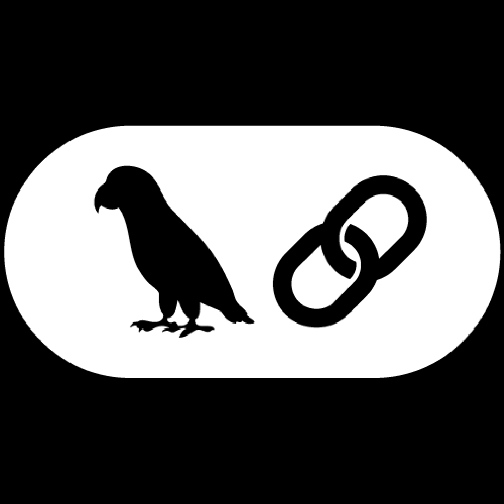
Models, vision and retrieval</td>
</tr>
<tr>
<td width="33%" valign="top"><strong>Molecular Dynamics</strong>
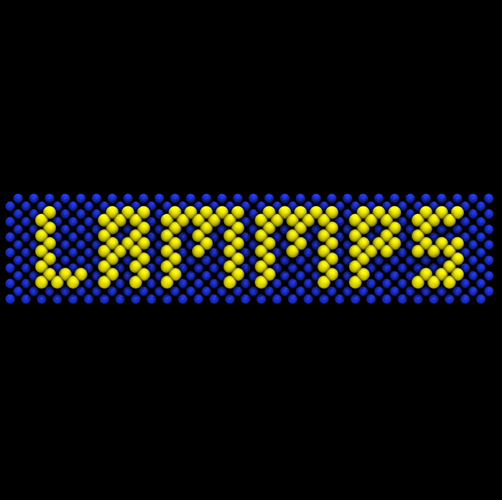 &nbsp; 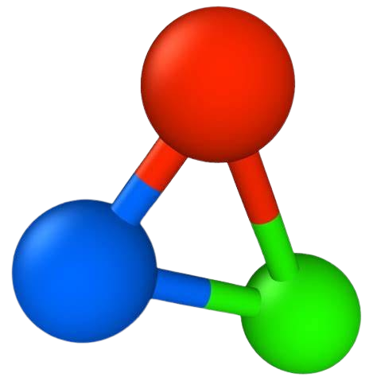 &nbsp; 
Simulation and visualization</td>
<td width="33%" valign="top"><strong>Prototyping & Graphics</strong>
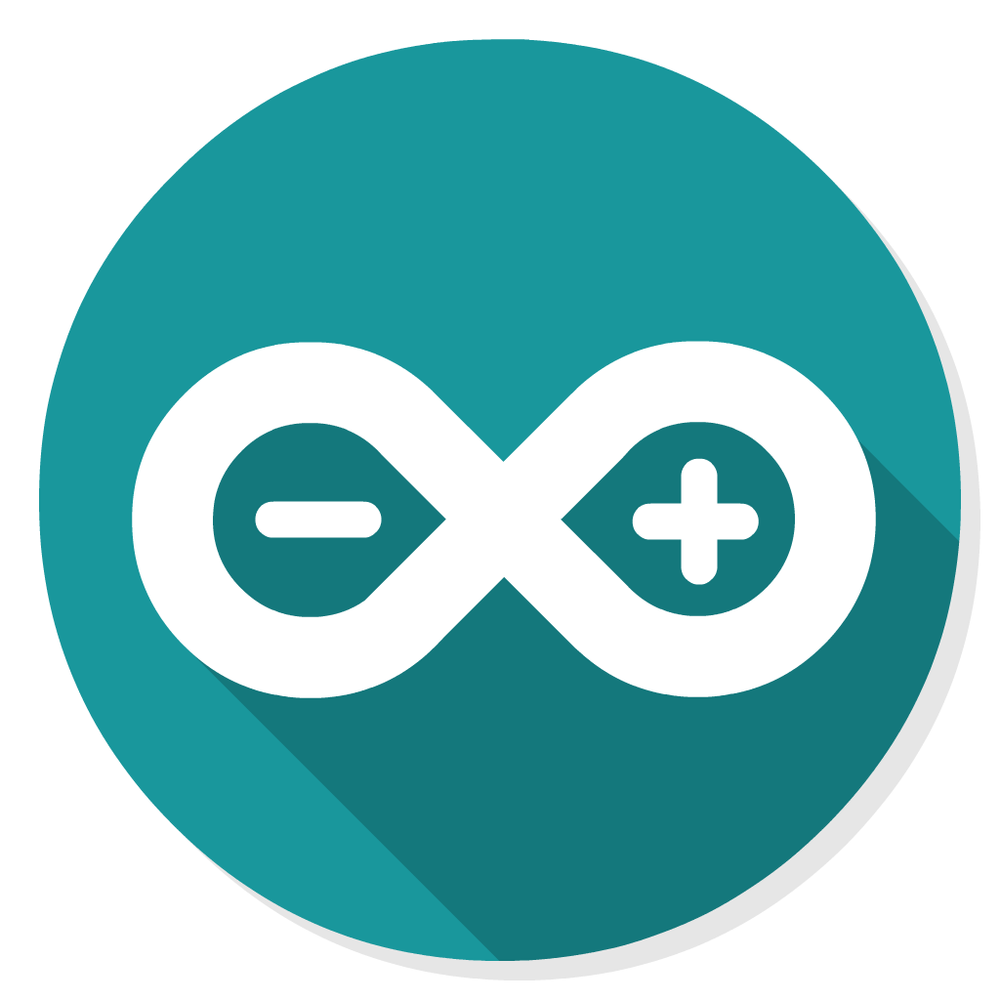 &nbsp; 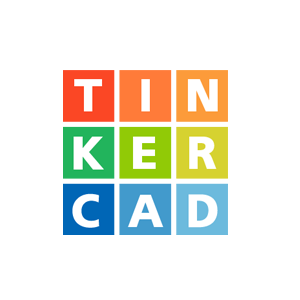 &nbsp; 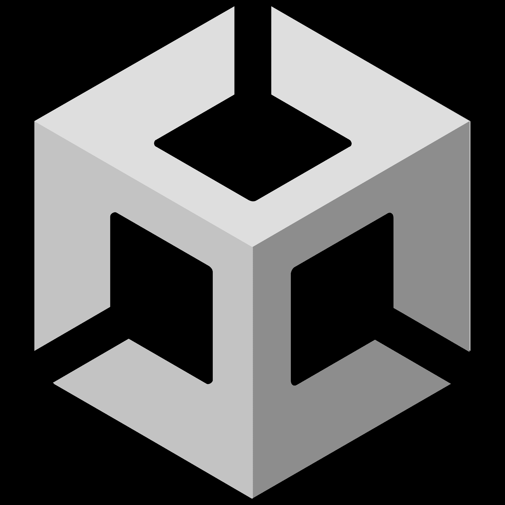 &nbsp;  &nbsp; 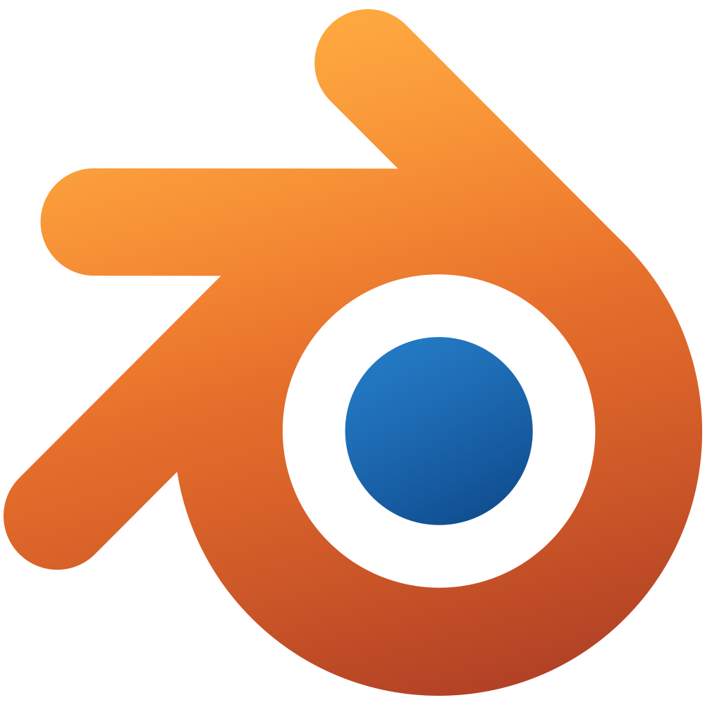
Electronics, games and 3D work</td>
<td width="33%" valign="top"><strong>Research Tools</strong>
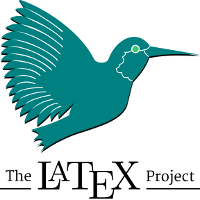 &nbsp; 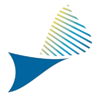 &nbsp; 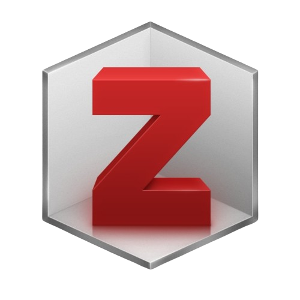
Writing, plots and references</td>
</tr>
</table>

Tools used across research, coursework and personal projects. Experience varies by tool.

## Explore More

<strong>Research & engineering background</strong>

### Selective Laser Melting

For my undergraduate thesis, I developed a <strong>Python-based moving heat-source solver from scratch</strong> for Ti-6Al-4V and Inconel-718. I compared steady-state/transient formulations and temperature-dependent property treatments against published melt-pool measurements.

A thesis-based paper has been <strong>accepted for oral presentation at ICMIME 2026</strong>.

### Engineering projects

- <strong>Heat exchanger:</strong> team project involving modified gaskets/baffles, CFD, fabrication and hydraulic testing.
- <strong>Varanus:</strong> quadruped robot with 3D-printed parts, Arduino gait control and ESP32-CAM integration.
- <strong>Control simulation:</strong> MATLAB/Simulink comparison of P, PI and PID wire-tension controllers.

[Research](https://sites.google.com/view/naimulnashid/research) · [Engineering portfolio](https://sites.google.com/view/naimulnashid/projects)

<strong>AI, simulation & learning projects</strong>

| Project | Focus |
| --- | --- |
| [GPT implementation](https://github.com/naimulnashid/LLM_from_Scratch) | PyTorch architecture and classification/instruction fine-tuning with pretrained GPT-2 weights. |
| [LangChain projects](https://github.com/naimulnashid/LangChain_Projects) | Retrieval, CSV/PDF question answering, natural-language-to-SQL and resume matching. |
| [Computer vision](https://github.com/naimulnashid/ComputerVision) | Hand-gesture volume control using OpenCV and MediaPipe. |
| [Reinforcement learning](https://github.com/naimulnashid/Reinforcemen_Learning) | Snake-game agent, environment and neural-network implementations. |
| [LAMMPS](https://github.com/naimulnashid/LAMMPS) | Aluminum, silica, electrolyte, polymer and nanotube simulation exercises. |
| [LabVIEW](https://github.com/naimulnashid/LabVIEW) | Water-tank level control. |
| [Arduino](https://github.com/naimulnashid/Arduino) | Undergraduate electromechanical systems project. |
| [Unity](https://github.com/naimulnashid/Unity) | Flappy Bird game project. |

<strong>Web versions & earlier implementations</strong>

- <strong>Data Usage:</strong> [web dashboard and Android reporter](https://github.com/naimulnashid/data-usage-tracker).
- <strong>Screen Time:</strong> [web dashboard and Android reporter](https://github.com/naimulnashid/screen-time-tracker).
- <strong>AI Usage:</strong> [earlier web dashboard](https://github.com/naimulnashid/ai-usage-tracker), superseded by the native app.
- <strong>Internet Speed Meter:</strong> [earlier meter and web dashboard](https://github.com/naimulnashid/internet-speed-meter), superseded by the native app.

Dhaka, Bangladesh · Engineering, research and useful software

